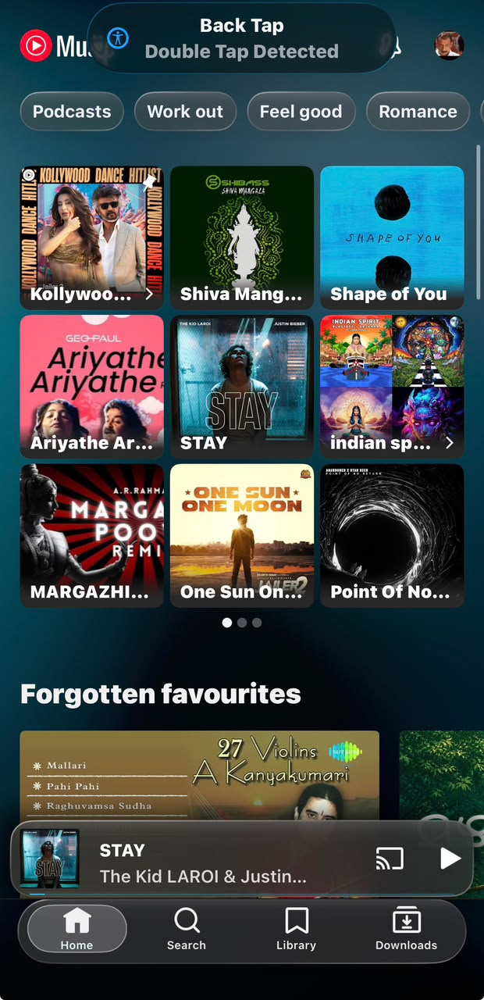
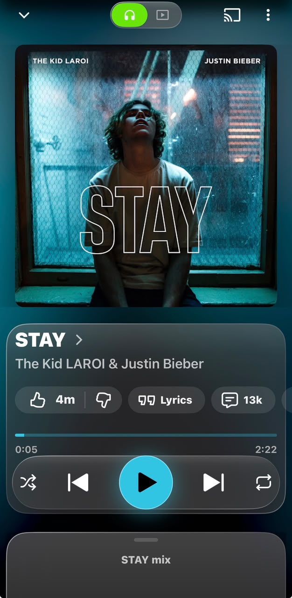
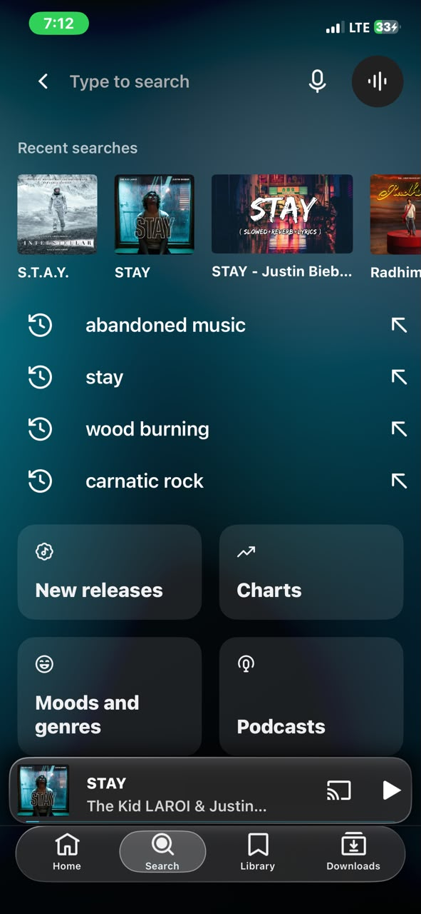

# YTMusicUltimate

    

The ultimate tweak for YouTube Music on iOS — enhanced by <a href="https://github.com/vyxiro"><strong>@vyxiro</strong></a> with a full <strong>iOS 26 Liquid Glass UI/UX Overhaul</strong>, <strong>Artwork Ambient Mode</strong>, <strong>Download Fixes</strong>, and <strong>Apple Audio &amp; Crossfade Integration</strong>.

## What's New & Contributed by [@vyxiro](https://github.com/vyxiro)

- **Full iOS 26 Liquid Glass UI/UX:** Specular glass rims, blurred live album-artwork backdrops, dynamic accent palette extraction (`LGTheme`), floating capsule bottom tab bar, aligned 5-button Now Playing controls, and transparent Related / Comments / Save to Playlist / Search / Recent Searches / Library / Notifications / Settings surfaces.
- **Playlists-Style Downloads & Crash Fix:** Redesigned Downloads section with playlist-style cards and fixed the Now Playing download button crash.
- **Native Dual-Deck Audio Crossfade (`Apple Audio & Network`):** Unlocked YouTube Music's `MLHAMMultiPlayer` / `YTPersistentAudioFadeController` pipeline alongside Gapless Album Detection, Deep Buffer Mode (`120s`), and Smart Next-Track Pre-Fetch (`YTM v9.47.2`).
- **Pre-Packaged Sideloading IPA & CI Pipeline:** Fixed `Package_IPA` Weak-Dylib Mach-O injection before `LC_CODE_SIGNATURE` and configured GitHub Actions (`macos-15-intel`) for fast automated builds.

## Liquid Glass UI Showcase (On-Device)

  
  
  

## Download Links

* **Pre-Patched IPA & Standalone Dylib (Sideloading — AltStore / SideStore / Sideloadly / Feather):**
  Download the latest **`YouTubeMusic_v9.47_LiquidGlass_Ultimate.ipa`** or **`YTMusicUltimate.dylib`** directly from **[GitHub Releases](https://github.com/vyxiro/YTMUSIC-GOD/releases)**.

* **Jailbreak / Custom Injection:**
  Grab the latest release assets from **[Releases](https://github.com/vyxiro/YTMUSIC-GOD/releases)** or build from source using Theos (`make clean package SIDELOADING=1`).

## Credits & Contributors

* **[@vyxiro](https://github.com/vyxiro)** — Liquid Glass & Ambient UI overhaul, Downloads redesign & crash fix, Native Audio Crossfade & Network enhancements, Mach-O IPA injection tooling, and `v9.47.2` build maintenance.
* **Ginsu & Dayanch96** — Original creators of [YTMusicUltimate](https://github.com/ginsudev/YTMusicUltimate).

## How to build a YTMusicUltimate IPA by yourself using Github actions

If this is your first time here, start from step 1. If you built a YTMU IPA before, skip steps 1 and 2. Instead, click on the "Sync fork" button to get the latest version of the tweak and continue through step 3.

1. Fork this repository using the fork button on the top right.
2. On your forked repository, go to Repository Settings > Actions, enable Read and Write permissions.
3. Go to the Actions tab on your forked repo, click on "Build and Release YTMusicUltimate" located on the left side. Click "Run workflow" button located on the right side.
4. Find a decrypted YTMusic .ipa file (we cannot provide you this due to legal reasons) and upload it to a file provider(filebin.net or Dropbox is recommended). Paste the url to the necessary field and click "Run workflow".
5. Wait for the build to finish. You can download the tweaked IPA from the releases section of your forked repo. (If you can't find the releases section, go to your forked repo and add /releases to the url. i.e github.com/user/YTMusicUltimate/releases)

## IPA building troubleshooting(I can't build the IPA/Github action fails/I can't find the releases section etc.)

99.9% of the time, the culprit is the IPA URL you provided. You HAVE TO provide a decryped IPA. It cannot be any other extension, it has to be a **.ipa** file. Find a decrypted YTMusic IPA(we can't help you with that), upload it to filebin.net or Dropbox, give the direct link to the GitHub action. If you find a working ipa and upload it properly, everything will start working perfectly, pinky promise.

If the github action works and you cannot find where you can download the result, you need to add /releases to the url of your forked repository. It'll probably look like this: https://github.com/YOURUSERNAME/YTMusicUltimate/releases, don't forget to replace the YOURUSERNAME part with your username. It may seem invisible but if the github action is successful, IPA will be there.

## How to build the package by yourself on your device
1. Install __[Theos](https://theos.dev/docs/installation)__
2. Clone this repo __[using git](https://docs.github.com/en/repositories/creating-and-managing-repositories/cloning-a-repository)__
3. Cd your YTMusicUltimate folder and run:

   • '**make clean package**' to build deb for rootful device
   
   • '**make clean package ROOTLESS=1**' to build deb for rootless device
   
   • '**make clean package SIDELOADING=1**' to build deb for injecting in to ipa
   
   

   • To learn how to inject tweaks in to ipa visit __[here (Azule)](https://github.com/Al4ise/Azule)__

Made with ❤️ by Ginsu & Dayanch96 • Enhanced by [@vyxiro](https://github.com/vyxiro)
